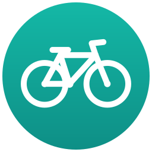

#  GBFS – Bike-Share Integration for Home Assistant

[](https://gbfs-ha-integration.blunan.com/)
[](https://github.com/blunan/gbfs-ha-integration/actions/workflows/test.yml)
[](https://github.com/blunan/gbfs-ha-integration/actions/workflows/validate.yml)


[](https://github.com/blunan/gbfs-ha-integration/blob/main/LICENSE)

Custom integration that monitors stations from **any** bike-share system publishing a [GBFS](https://gbfs.org/) feed — Ecobici CDMX, Citi Bike, Vélib', Divvy, and hundreds more. Paste the system's `gbfs.json` URL, pick your stations by name, and each one becomes a device with live sensors.

> 📖 **Full documentation at [gbfs-ha-integration.blunan.com](https://gbfs-ha-integration.blunan.com/):** every entity in detail, dashboard and automation examples, supported feeds, and troubleshooting.

## ✨ Features

* 🖱️ **100% UI-based setup** — no YAML. Paste the `gbfs.json` URL and the integration discovers the station feeds, in your Home Assistant language when the system publishes several.
* 🔀 **Every GBFS version** — 1.x, 2.x, and 3.0 feeds give the same sensors, with translated station names when the feed has them.
* 🚲 **One device per station** with sensors for available bikes, e-bikes, docks, occupancy %, out-of-service bikes/docks, and last report time, plus renting/returning binary sensors.
* 🧠 **Feed-aware entities** — optional sensors (e-bikes, disabled bikes/docks) are only created when the feed actually publishes those fields. E-bikes are counted directly or by vehicle type.
* 📡 **Efficient polling** — a single request to `station_status.json` every 60 s (or the feed's `ttl`, if longer) updates all your stations.
* 📈 **Long-term statistics ready** — numeric sensors use `state_class: measurement`, so they work with HA statistics and InfluxDB/Grafana export.
* 🗺️ **Map friendly** — the bikes sensor carries the station's latitude/longitude, so stations show up on the map card.
* 🔁 **Options flow** — add or remove stations at any time without reinstalling.
* 🩺 **Diagnostics support** — download the entry's update state, published fields, and per-station data from **Devices & Services** for easy debugging.
* 🌐 **Translations** — English and Spanish.

## 📦 Installation

### Home Assistant 2026.11 or later: Marketplace

1. Go to **Settings → Marketplace** and select **Add from link**.
2. Enter `https://github.com/blunan/gbfs-ha-integration` and select **Add**.
3. Open **GBFS**, select **Install**, and restart Home Assistant if asked.

### Home Assistant 2026.3 – 2026.10: HACS

[](https://my.home-assistant.io/redirect/hacs_repository/?owner=blunan&repository=gbfs-ha-integration&category=integration)

Or add it manually:

1. HACS → ⋮ → **Custom repositories**.
2. Add repository URL `https://github.com/blunan/gbfs-ha-integration` with type **Integration**.
3. Download **GBFS** and restart Home Assistant.

### Manual

Copy `custom_components/gbfs/` into the `custom_components/` directory of your Home Assistant configuration and restart.

The [installation guide](https://gbfs-ha-integration.blunan.com/installation/) also covers updates and uninstalling.

## ⚙️ Configuration

[](https://my.home-assistant.io/redirect/config_flow_start/?domain=gbfs)

1. **Settings → Devices & Services → Add Integration → GBFS**.
2. Paste the auto-discovery URL of your bike-share system, e.g. Ecobici CDMX:
   `https://gbfs.mex.lyftbikes.com/gbfs/gbfs.json`
3. Select your stations by name from the multi-select list.
4. Done — each station appears as a device with its sensors. You can add or remove stations at any time via **Configure** on the integration entry.

### 🔍 Finding Your System's GBFS Feed

GBFS feeds are published openly by transit authorities and bike-share operators worldwide. To find the feed URL for your city:

* Search MobilityData's official [systems catalog (`systems.csv`)](https://github.com/MobilityData/gbfs/blob/master/systems.csv) — the **Auto-Discovery URL** column — or the [Mobility Database](https://mobilitydatabase.org/feeds).
* Check your municipal open-data portal or bike-share operator's developer page.

Use the auto-discovery URL, which usually ends in `gbfs.json`.

## 🚲 Entities per Station

| Entity | Type | GBFS source | Notes |
|--------|------|-------------|-------|
| Bikes available | Sensor | `num_bikes_available` (3.0: `num_vehicles_available`) | Carries `latitude`/`longitude` attributes for the map |
| E-bikes available | Sensor | `num_ebikes_available`, or counts by vehicle type | Only if the feed counts e-bikes |
| Bikes disabled | Sensor | `num_bikes_disabled` (3.0: `num_vehicles_disabled`) | Only if the feed publishes it |
| Docks available | Sensor | `num_docks_available` | |
| Docks disabled | Sensor | `num_docks_disabled` | Only if the feed publishes it |
| Occupancy | Sensor | calculated | `bikes / (bikes + docks) × 100` |
| Last reported | Sensor | `last_reported` | Timestamp, diagnostic |
| Renting | Binary sensor | `is_renting` | Station is renting bikes |
| Returning | Binary sensor | `is_returning` | Station is accepting returns |

Entity IDs combine the station and entity names: Ecobici's *CE-003 Reforma - Insurgentes* station gets `sensor.ce_003_reforma_insurgentes_bikes_available`, `sensor.ce_003_reforma_insurgentes_occupancy`, and so on.

## 📊 Dashboard Example

Because the **Bikes available** sensor includes the station's coordinates, stations can be plotted on a Map card, with each marker showing its bike count:

```yaml
type: map
title: Bike-Share Stations
entities:
  - entity: sensor.ce_003_reforma_insurgentes_bikes_available
    label_mode: state
  - entity: sensor.ce_029_reforma_bucareli_bikes_available
    label_mode: state
default_zoom: 15
```

More [dashboard and automation examples](https://gbfs-ha-integration.blunan.com/examples/): gauges, statistics graphs, commute alerts, and stale-station checks.

## ⚠️ Requirements & Limitations

* **Station-based feeds only:** The feed must publish both `station_information.json` and `station_status.json`. Dockless-only systems (`free_bike_status.json` only) without stations are not supported.
* **Public feeds:** Only publicly accessible URLs without authentication or custom headers are supported.
* **Bikes and e-bikes only:** Other vehicles docked at stations, such as scooters, aren't counted separately.

## 🩺 Troubleshooting

* **Diagnostics:** Go to **Settings → Devices & Services → GBFS → ⋮ → Download diagnostics** to inspect the entry, update state, published fields, and raw station data.
* **Debug Logging:** To enable debug logs for this integration, add the following to `configuration.yaml` and restart Home Assistant:

```yaml
logger:
  default: info
  logs:
    custom_components.gbfs: debug
```

The [troubleshooting guide](https://gbfs-ha-integration.blunan.com/troubleshooting/) covers setup errors, unavailable or unknown sensors, and what to include in a bug report.

## 📖 Documentation

| Page | What's in it |
|------|--------------|
| 📦 [Installation](https://gbfs-ha-integration.blunan.com/installation/) | Marketplace, HACS, and manual installs; updates and uninstalling |
| ⚙️ [Configuration](https://gbfs-ha-integration.blunan.com/configuration/) | Finding your feed, setup errors, changing stations, and several systems |
| 🚲 [Entities](https://gbfs-ha-integration.blunan.com/entities/) | Every sensor, occupancy, availability, update interval, and entity IDs |
| 📊 [Dashboards and automations](https://gbfs-ha-integration.blunan.com/examples/) | Map, gauge, and statistics cards; commute alerts and stale-station checks |
| 🌐 [Supported feeds](https://gbfs-ha-integration.blunan.com/feeds/) | GBFS versions, languages, fields read, e-bikes, and what isn't supported |
| 🩺 [Troubleshooting](https://gbfs-ha-integration.blunan.com/troubleshooting/) | Diagnostics, debug logs, common problems, and reporting issues |
| 🛠️ [Development](https://gbfs-ha-integration.blunan.com/development/) | Dev container, scripts, tests, architecture, CI, and releases |

## 🤝 Contributing

Contributions, issues, and feature requests are welcome! The [development guide](https://gbfs-ha-integration.blunan.com/development/) covers the dev container, scripts, tests, and how to open a pull request.

## 📄 License

This project is licensed under the MIT License — see the [LICENSE](https://github.com/blunan/gbfs-ha-integration/blob/main/LICENSE) file for details.
